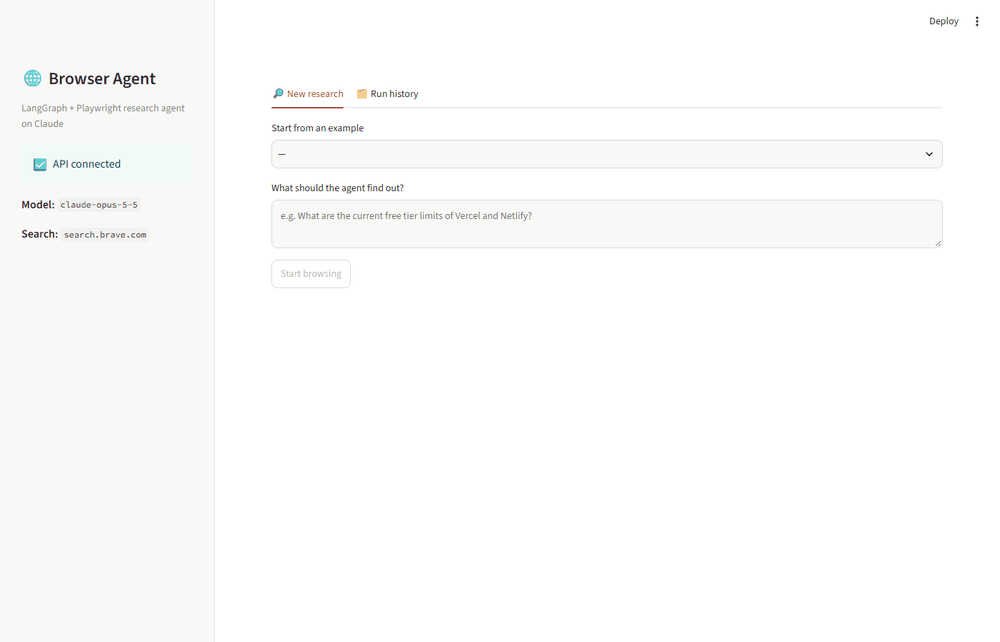
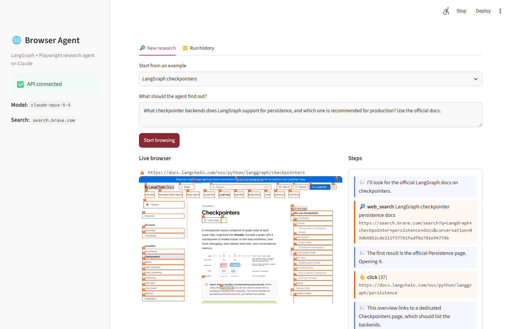
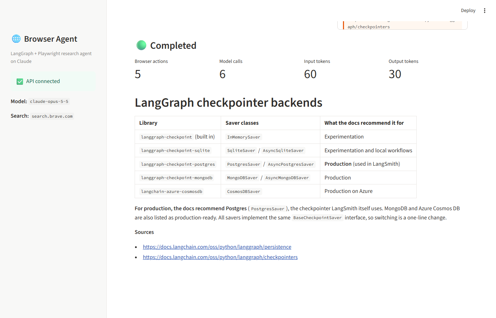
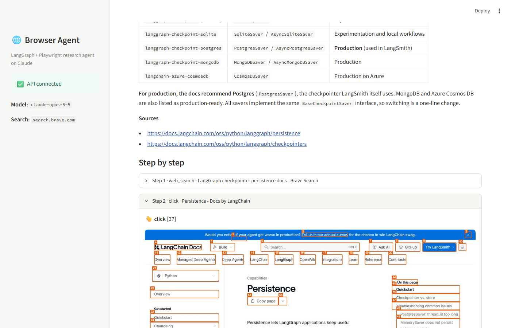
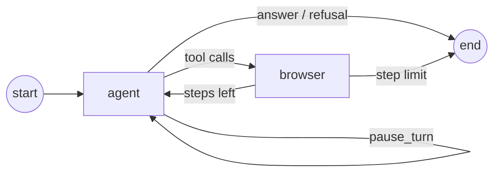

# Browser Agent

[](https://github.com/yordanossimegnew/browser_agent/actions/workflows/tests.yml)  [](LICENSE)

A web research agent that operates a real browser. Ask a question; it searches, opens
pages, clicks through docs, reads and extracts what it needs, and answers with sources.
Built with **LangGraph** and **LangChain**, **Playwright** for the browser, served as a
**FastAPI** app with a live-streaming **Streamlit** UI.



<sub>Demo uses scripted model replies; the browsing (Brave Search, LangChain docs) and the UI are real.</sub>

| Live browser view | Answer with sources | Run history |
|---|---|---|
|  |  |  |

## Engineering highlights

- Set-of-marks perception: Claude sees a numbered element list, the page text and a screenshot with the same numbers drawn on it, then acts by number. This is more reliable than guessing CSS selectors.
- Playwright's sync API is tied to one thread, so each run gets its own worker thread and browser; HTTP handlers only read the run's event log.
- Every step (thought, action, screenshot) streams to the UI over Server-Sent Events while the run is in progress.
- SSRF guard: private and localhost addresses are blocked unless explicitly allowed.

## Features

- **LangGraph orchestration:** an `agent` → `browser` → `agent` state graph with conditional routing
  and a PostgreSQL checkpointer that records every run.
- **LangChain `ChatAnthropic`** for Claude (`claude-opus-5-5`, adaptive thinking, vision).
- **How the agent sees a page:** after every action Claude gets
  1. a numbered list of interactive elements (`[16] link "Persistence - Docs by LangChain"`),
  2. the visible page text, and
  3. a **screenshot with the same numbers drawn on the elements** ("set-of-marks").
  
  It then acts by number (`click(16)`), which is far more reliable than guessing CSS selectors.
- **7 browser tools:** `web_search`, `navigate`, `click`, `type_text`, `scroll`, `go_back`,
  `read_page` (full text in parts, so long docs pages lose nothing).
- **Live streaming:** runs execute in the background and stream each step (thought, action,
  screenshot) over **Server-Sent Events**. The UI shows the browser as it moves.
- **Safety:**
  - An **SSRF guard** blocks `localhost`, private/LAN and cloud-metadata addresses and non-http(s)
    schemes. It covers redirects and clicked links as well as direct navigation.
  - Optional domain blocklist.
  - Web content is treated as untrusted (prompt-injection-aware system prompt).
  - No credential entry, purchases or form posting.
- **Robust loop:** strict tool schemas, errors returned to the model *with* the current page,
  truncated tool calls answered instead of run, and a step limit.
- **Offline test suite:** real headless Chromium against a local test site, with a scripted
  model. No API key or internet needed.

## Project structure

```
browser-agent/
├── README.md
├── requirements.txt
├── .env.example            # copy to .env (never commit .env)
├── .gitignore
├── Dockerfile              # Python + Chromium (playwright install --with-deps)
├── docker-compose.yml      # API on :8000, UI on :8501
├── main.py                 # FastAPI app (`main:app`) + terminal CLI
├── ui/
│   └── app.py              # Streamlit UI: live browser view, steps, run history
├── docs/                   # demo.gif + screenshots
├── src/
│   ├── agent/
│   │   ├── agent.py        # LangGraph StateGraph: agent + browser nodes, routing
│   │   ├── executor.py     # runs a browser action -> ToolMessage (text + screenshot)
│   │   ├── state.py        # graph state, token usage, results
│   │   └── memory.py       # PostgreSQL checkpointer, transcript export
│   ├── tools/
│   │   ├── browser.py      # Playwright session, element labelling, screenshots, SSRF guard
│   │   ├── actions.py      # the 7 tools the model can call
│   │   └── base.py         # Tool definition + strict schemas
│   ├── models/
│   │   └── llm_client.py   # LangChain ChatAnthropic (effort, caching, refusal fallback)
│   ├── prompts/
│   │   ├── system_prompts.py   # how to browse, cite, and treat page content
│   │   └── agent_prompts.py    # system prompt + knowledge base assembly
│   ├── utils/              # config (env/.env), logging, text helpers
│   └── api/
│       ├── runs.py         # background runs on worker threads + event log
│       ├── routes.py       # FastAPI endpoints incl. SSE stream
│       └── schemas.py      # Pydantic models
├── tests/
│   ├── site/               # tiny local website the browser tests run against
│   ├── test_tools.py       # real Chromium: perception, actions, SSRF guard
│   ├── test_agent.py       # LangGraph loop with a scripted model
│   └── test_api.py         # endpoints + Server-Sent Events
├── data/
│   ├── examples.json       # sample research tasks
│   └── knowledge_base/     # research guidelines injected into the system prompt
└── logs/
```

## Setup

```bash
cd browser-agent
python -m venv .venv
# Windows: .venv\Scripts\activate   |   macOS/Linux: source .venv/bin/activate
pip install -r requirements.txt
python -m playwright install chromium
cp .env.example .env              # set ANTHROPIC_API_KEY, DATABASE_URL and TEST_DATABASE_URL
```

Create the two PostgreSQL databases once (in psql or pgAdmin). LangGraph creates its checkpoint
tables on first start:

```sql
CREATE DATABASE browser_agent;
CREATE DATABASE browser_agent_test;   -- used only by pytest
```

## Run the API

```bash
uvicorn main:app --reload         # or: python main.py      ->  http://localhost:8000/docs
```

| Method | Path                       | Description                                                |
|--------|----------------------------|------------------------------------------------------------|
| GET    | `/health`                  | Status, model, search engine                               |
| POST   | `/runs`                    | Start a run in the background → `{run_id, events_url}`     |
| GET    | `/runs/{id}/events`        | **Server-Sent Events**: every thought, action and screenshot |
| GET    | `/runs/{id}`               | Status, result and all events (`?screenshots=false` to slim) |
| GET    | `/runs`                    | Recent runs                                                |
| GET    | `/runs/{id}/transcript`    | Full LangGraph message history (from the checkpointer)     |
| POST   | `/run`                     | Run and wait for the answer (no streaming)                 |

```bash
# Start a run and watch it live
curl -X POST localhost:8000/runs -H "Content-Type: application/json" \
  -d '{"task": "What checkpointer backends does LangGraph support?"}'
curl -N localhost:8000/runs/<run_id>/events
```

Each event is one JSON object, for example:

```json
{"seq": 4, "type": "observation", "step": 2, "tool": "click", "args": {"element_id": 16},
 "url": "https://docs.langchain.com/oss/python/langgraph/persistence",
 "title": "Persistence - Docs by LangChain", "is_error": false, "screenshot": "<base64 jpeg>"}
```

## Run the Streamlit UI

With the API running, in a second terminal:

```bash
streamlit run ui/app.py           # http://localhost:8501
```

## Terminal CLI (optional)

```bash
python main.py cli "Compare the free tiers of Vercel and Netlify"
python main.py cli --show "..."   # watch the real browser window
```

## Docker

```bash
docker compose up --build         # API on :8000, UI on :8501
```

## Tests

```bash
pytest -q                         # spins up headless Chromium + a local test site
```

## Configuration

| Variable                      | Default                                     | Meaning                                  |
|-------------------------------|---------------------------------------------|------------------------------------------|
| `AGENT_MODEL`                 | `claude-opus-5-5`                           | Claude model id                          |
| `AGENT_EFFORT`                | `high`                                      | Thinking depth: `low` … `max`            |
| `AGENT_MAX_STEPS`             | `20`                                        | Max model calls per run                  |
| `SEARCH_URL`                  | `https://search.brave.com/search?q={query}` | Search engine used by `web_search`       |
| `BROWSER_HEADLESS`            | `true`                                      | `false` shows the browser window         |
| `BROWSER_BLOCKED_DOMAINS`     | *(empty)*                                   | Comma-separated domains to refuse        |
| `BROWSER_ALLOW_PRIVATE_HOSTS` | `false`                                     | Keep `false` (SSRF protection)           |
| `MAX_CONCURRENT_RUNS`         | `2`                                         | Browsers running at the same time        |

> Brave Search is the default because Google and DuckDuckGo show bot checks to headless
> browsers. Any engine with a `?q=` URL works via `SEARCH_URL`.

## How the graph works



1. **`agent` node:** Claude (via `ChatAnthropic` with the tools bound) sees the task and every
   observation so far and decides the next action, or writes the final answer with sources.
2. **`browser` node:** Playwright performs the action, then labels the page and takes a
   screenshot. The result goes back as a `ToolMessage` containing text and an image.
3. **Events:** both nodes emit events (thought, action, observation) that the API streams to
   the UI as they happen.
4. **Checkpointing:** the PostgreSQL checkpointer saves state after every node, keyed by `run_id`.

Playwright's sync API is tied to the thread that started it, so each run gets its own worker
thread and browser ([`src/api/runs.py`](src/api/runs.py)). HTTP handlers only read the event log.

## Ideas to extend

- Human-in-the-loop approval for `type_text` using LangGraph `interrupt()`.
- Run several browser agents in parallel on sub-questions and merge their findings.
- Save extracted data straight to structured JSON with `output_config.format`.
